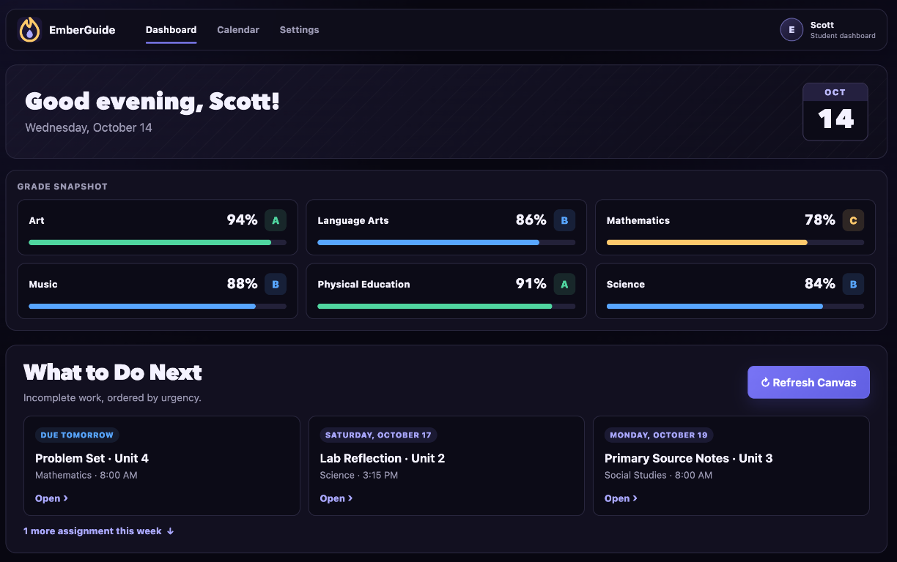
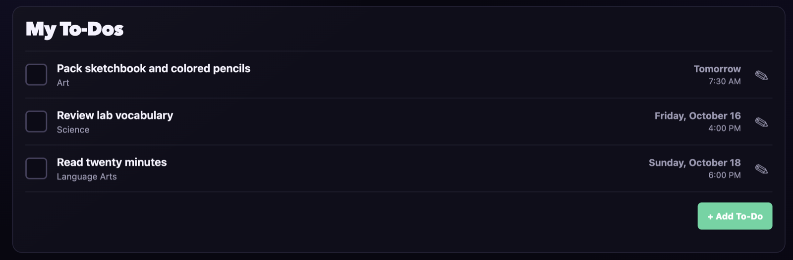
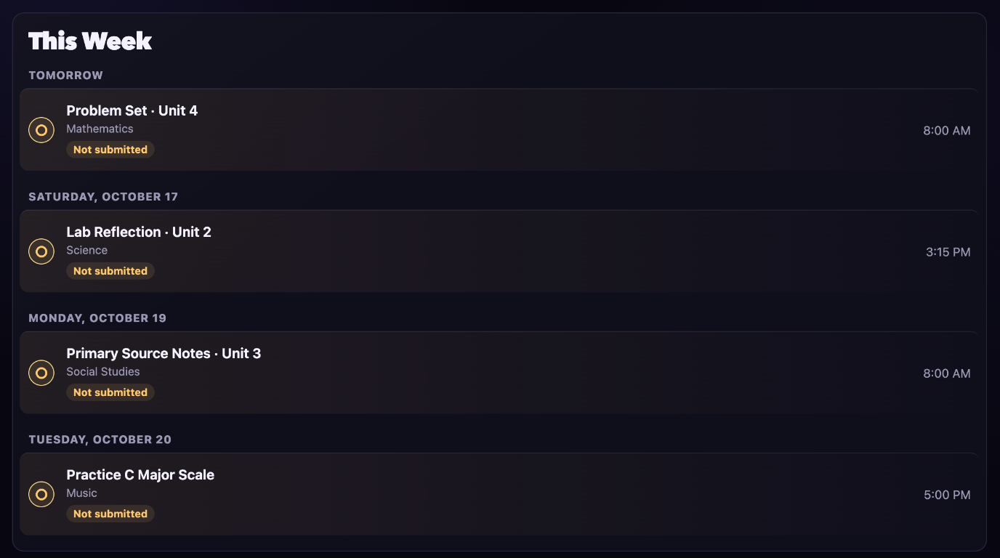
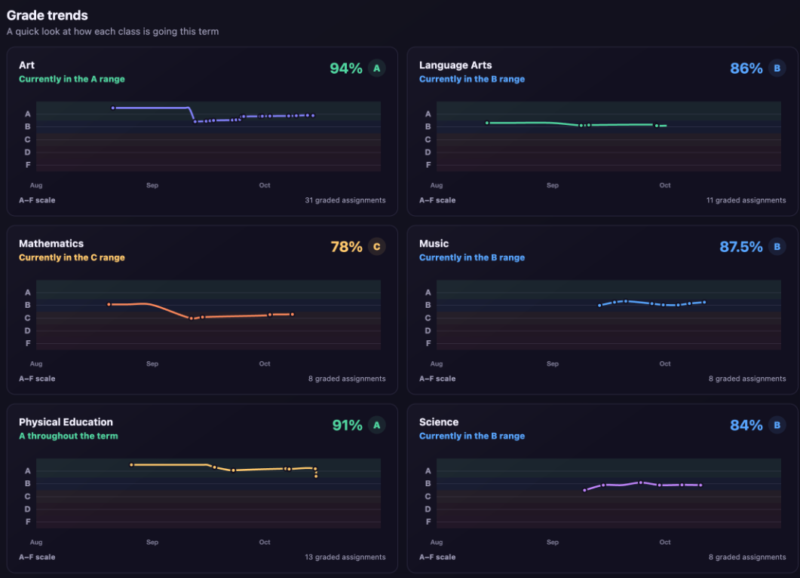
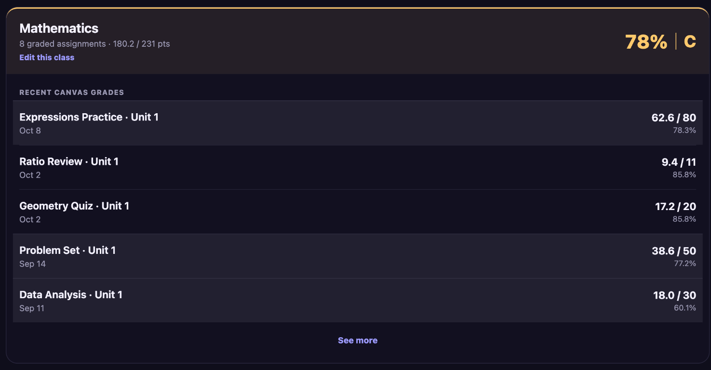

# 🔥 EmberGuide

A lightweight, family-friendly dashboard for [Canvas LMS](https://www.instructure.com/canvas) built with Ruby.

The dashboard provides a simple view of the school information that matters most day-to-day:

* ⚠️ Missing assignments
* ✅ Canvas to-do list with completion controls
* 📅 Assignments due in the next 7 days
* ✅ Submission status
* 📊 Editable assignment grades, calculated course estimates, and recent scores
* ✍️ Manual classes and assignments for coursework outside Canvas
* 🔑 Canvas API token expiration
* 💾 Cached data when Canvas is temporarily unavailable
* 🏠 Home Assistant status and change-event API
* 📱 Mobile and iPad-friendly interface
* 🎓 Branded Home Assistant app-store artwork

The interface uses a responsive dark analytics theme with compact navigation,
high-contrast cards, and locally rendered grade trend charts.

It was designed to run continuously as a **Home Assistant add-on on a Raspberry Pi**, but it can also be run locally on macOS or another machine with Ruby.

---

## Why?

Canvas contains a lot of information, but checking several courses to answer a simple question like:

> "What homework do I still need to do?"

can require a surprising amount of navigation.

This dashboard uses the Canvas API to collect that information and present it on a single page designed to be left open, bookmarked, or added to an iPad Home Screen.

---

## Product tour

### See the whole school day at a glance



EmberGuide turns a busy Canvas account into one calm starting point. The
dashboard combines current course averages with a short, urgency-ordered list
of what needs attention next, so students can answer “What should I work on?”
without opening every class.

### Keep small responsibilities from slipping through



Canvas planner notes and personal reminders live together in a focused to-do
list. Students can add, edit, and complete items directly from the dashboard,
while course labels and due times keep each task grounded in the school day.

### Make the rest of the week predictable



The seven-day view groups assignments by date and shows the class, due time,
and submission status at a glance. Canvas work and manually tracked classes
share the same timeline, giving families one dependable view of the week ahead.

### Show progress as a trend, not a verdict



Encouraging Chart.js cards place every class on the same A–F scale and rebuild
the cumulative grade after each assignment. Students can see whether a class
is steady, improving, or needs attention without overreacting to a single
score.

### Explain the number behind the letter



Course details connect the overall percentage to the assignments that produced
it. Recent scores, points possible, dates, and percentages make the estimate
easy to understand, while local grade editing supports corrections and work
tracked outside Canvas.

> **Demo data:** Every grade, assignment, date, and score shown above is
> illustrative data created for the EmberGuide demo. The displayed profile does
> not contain a real student's academic record.

---

## Features

EmberGuide is organized around the questions students and families ask every
day: What needs attention, what is coming next, and how is each class going?

### 🎯 A clear next step

**What to Do Next** turns missing and upcoming work into a short,
urgency-ordered action list. Missing assignments remain prominent, while direct
Canvas links make it easy to move from planning to doing.

### ✅ To-dos and a predictable week

Create, edit, and complete Canvas planner notes without leaving the dashboard.
The seven-day view groups coursework by date and shows each class, due time,
and submission status, including work from classes tracked outside Canvas.

### 📈 Encouraging grade context

A compact snapshot shows every current course average, while locally rendered
Chart.js trends rebuild the cumulative grade after each assignment on a shared
A–F scale. Open any class to connect the overall letter grade to recent scores,
points possible, and dates.

Local grade tools can correct stale Canvas values, add grades from another
system, or temporarily hide an inaccurate assignment until Canvas updates. All
changes stay inside EmberGuide and never modify the Canvas gradebook.

> **Grade estimates:** EmberGuide calculates percentages from assignments
> available through the API. Weighted groups, grading periods, dropped work,
> and other teacher gradebook rules can make the official Canvas grade differ.

### 🧩 One place for every class

Add manual classes and assignments for coursework outside Canvas. Long Canvas
course names can be shortened, and irrelevant enrollments can be hidden
locally, without changing the student's actual Canvas enrollment.

### ✉️ Family-friendly digests and backups

Preview, send on demand, or schedule a responsive morning digest containing the
current grade snapshot, missing work, near-term assignments, schedule changes,
and recently posted grades. Download or email a checksum-verified ZIP backup of
cached and locally managed data without including Canvas or Gmail credentials.

### 🏠 Designed for an always-on family dashboard

EmberGuide refreshes Canvas every ten minutes, caches the last successful
response for outages, and includes responsive/PWA metadata for phones and iPad
Home Screens. It runs locally or as a Home Assistant app on an always-on device
such as a Raspberry Pi.

### 🔔 Home Assistant awareness

Successful refreshes produce structured activity for missing work,
submissions, grades, due-date changes, and teacher feedback. Home Assistant can
turn those events into household notifications and automations, while status
and event APIs support other local integrations.

---

# Home Assistant Installation

The dashboard can run continuously as a Home Assistant app installed directly from GitHub.

This is particularly useful when Home Assistant OS is running on an always-on Raspberry Pi.

## Add the Repository

1. In Home Assistant, open **Settings → Apps → Install app**.
2. Open the three-dot menu and select **Repositories**.
3. Add this repository URL:

```text
https://github.com/sbalentine/emberguide
```

4. Refresh the app store and select **EmberGuide**.
5. Install the app and enter the Canvas configuration below.

---

## Home Assistant Configuration

The included `config.yaml` defines the add-on and exposes the dashboard web server.

Example:

```yaml
name: "EmberGuide"
description: "A clear, family-friendly guide to Canvas coursework"
version: "1.0.0"
url: "https://github.com/sbalentine/emberguide"
slug: "canvas_dashboard"
init: false

arch:
  - aarch64

ports:
  4567/tcp: 4567

ports_description:
  4567/tcp: "EmberGuide"

map:
  - addon_config:rw

options:
  canvas_url: ""
  canvas_token: ""
  token_expires: ""
  gmail_sender: ""
  gmail_app_password: ""

schema:
  canvas_url: str
  canvas_token: password
  token_expires: str
  gmail_sender: str
  gmail_app_password: password
```

Configure the Canvas URL, token, and expiration date through the Home Assistant add-on configuration. The Gmail sender and app password are optional and only required for scheduled emails.

The token is provided to the application through Home Assistant's `/data/options.json` and does **not** need to be stored in the Git repository.

---

## Building the Add-on

After placing or updating the files:

1. Open **Home Assistant**
2. Go to **Settings → Apps**
3. Open the local **EmberGuide** add-on
4. Rebuild/update the add-on
5. Start it
6. Check the add-on logs

A successful startup should look similar to:

```text
Starting EmberGuide...
Loading cached Canvas data...
EmberGuide listening on port 4567
Refreshing Canvas data...
Canvas cache saved.
Canvas refresh successful at ...
```

---

## Activity Events and API

When installed in Home Assistant, EmberGuide fires each detected Canvas change
on the event bus as `emberguide_activity`. Create an automation with an **Event**
trigger using that event type; payload fields are available under
`trigger.event.data`.

Detected activity types include:

* `assignment_missing`
* `assignment_no_longer_missing`
* `assignment_submitted`
* `grade_posted`
* `grade_changed`
* `due_date_changed`
* `teacher_feedback_added`

For other local integrations, `GET /api/status` returns dashboard counts and the
latest event, while `GET /api/events?after=42&limit=100` returns events after a
known event ID. EmberGuide retains the latest 500 changes locally.

---

# Running Locally

## Requirements

You'll need:

* Ruby
* WEBrick
* A Canvas API access token

Check Ruby:

```bash
ruby --version
```

Install WEBrick if necessary:

```bash
gem install webrick
```

---

## Canvas API Token

Generate an access token through your Canvas account.

The exact location depends on how your school configures Canvas, but Canvas normally exposes access tokens through the user's account settings when permitted by the institution.

**Never commit your Canvas token to Git.**

---

## Local Configuration

Create a `.env` file in the project root:

```bash
CANVAS_URL='https://your-school.instructure.com'
CANVAS_TOKEN='your-canvas-token'
TOKEN_EXPIRES='YYYY-MM-DD'
```

For example:

```bash
CANVAS_URL='https://your-school.instructure.com'
CANVAS_TOKEN='your-secret-token-here'
TOKEN_EXPIRES='2026-12-14'
```

`.env` is excluded by `.gitignore`.

---

## Start the Dashboard

Make the local startup script executable:

```bash
chmod +x run-local.sh
```

Then run:

```bash
./run-local.sh
```

Open:

```text
http://localhost:4567
```

### Running Tests

Install the development dependencies and run the test suite:

```bash
bundle install
bundle exec ruby test/run.rb
```

The suite does not contact Canvas. GitHub Actions runs it on the latest Ruby version pinned in `.ruby-version` and builds the ARM64 Home Assistant image for every push and pull request.

The first launch may briefly display a waiting message while the initial Canvas API request completes.

After a successful refresh, local cached data is stored at:

```text
emberguide/tmp/canvas_cache.json
```

The `tmp` directory is ignored by Git.

---

# Configuration

The application supports two configuration environments.

### Home Assistant

Home Assistant stores configuration in:

```text
/data/options.json
```

Expected options:

```json
{
  "canvas_url": "https://your-school.instructure.com",
  "canvas_token": "...",
  "token_expires": "YYYY-MM-DD",
  "gmail_sender": "sender@gmail.com",
  "gmail_app_password": "..."
}
```

### Local Development

Local development uses environment variables:

```text
CANVAS_URL
CANVAS_TOKEN
TOKEN_EXPIRES
GMAIL_SENDER
GMAIL_APP_PASSWORD
```

`run-local.sh` loads these values from `.env`.

---

### Scheduled Email Delivery

Gmail delivery is optional. Set `gmail_sender` and `gmail_app_password`, restart
EmberGuide, then configure recipients and schedules under **Scheduled Emails**.
Use a Google app password rather than the account's normal password.

The daily digest can be previewed without sending, delivered on demand, or
scheduled for 6:00 AM local time. Backups can be downloaded directly, emailed
on demand, or scheduled for 3:00 AM. Backup archives never include
`/data/options.json`, Canvas tokens, or Gmail credentials.

---

# Canvas API

The dashboard communicates with the Canvas REST API using Bearer-token authentication.

Requests use:

```text
Authorization: Bearer <CANVAS_TOKEN>
```

The application currently retrieves information including:

* Active courses
* Graded submissions
* Missing submissions
* Upcoming events/assignments
* Submission information for upcoming assignments

The Canvas instance URL (for example `https://your-school.instructure.com`) is configured with the `canvas_url` add-on option in Home Assistant, or the `CANVAS_URL` environment variable for local development and tests. The application will not start if it is missing or blank.

---

# Security

The Canvas access token provides access to information available to the associated Canvas account. The Gmail app password permits the dashboard to send mail through the configured Google account.

Treat it like a password.

Do not:

* Commit it to Git
* Put it in `README.md`
* Include it in screenshots
* Store it directly in source code
* Publish `/data/options.json`
* Publish your local `.env`
* Include the Canvas token or Gmail app password in a backup archive

The repository's `.gitignore` excludes common secret and runtime files, but always review changes before pushing:

```bash
git status
```

You can also search the repository before publishing:

```bash
grep -RniE 'access_token|canvas_token|Bearer ' . \
  --exclude-dir=.git \
  --exclude='.gitignore'
```

References to variable names such as `canvas_token` or `"Bearer #{TOKEN}"` are expected. An actual token value should never appear.

---

# Development Workflow

Run the dashboard locally:

```bash
./run-local.sh
```

Make changes and test at:

```text
http://localhost:4567
```

Check Ruby syntax:

```bash
ruby -c emberguide/app.rb
ruby -c emberguide/lib/canvas.rb
ruby -c emberguide/lib/helpers.rb
ruby -c emberguide/lib/dashboard_data.rb
```

Then commit:

```bash
git add .
git commit -m "Describe the change"
git push
```

Once the changes are working locally, increase the version in `emberguide/config.yaml` and push the changes. Home Assistant will then offer the new version as an update.

## Demo mode

EmberGuide includes a committed anonymized dataset for screenshots, product
evaluation, and local development without a Canvas connection:

```sh
ruby emberguide/app.rb --demo
```

The bundled data uses synthetic classes, assignments, IDs, URLs, and academic
records. Dates shift relative to the current day each time the app starts. All
writable settings are isolated under `emberguide/tmp/demo`, and Canvas
refreshes and scheduled email delivery are disabled.

Rebuild the bundled dataset from an existing local cache after the dashboard
data shape changes:

```sh
ruby script/create_demo_data.rb
```

Review the generated files in `emberguide/demo` before committing them.

## Project Structure

```text
emberguide/
├── repository.yaml
├── run-local.sh
├── test/
└── emberguide/
  ├── app.rb
  ├── Dockerfile
  ├── config.yaml
  ├── run.sh
  ├── lib/
  ├── views/
  ├── public/
  └── tmp/                # Local only; ignored by Git
```

### `emberguide/app.rb`

Starts the WEBrick web server and defines the dashboard, stylesheet, icon, and PWA manifest routes.

### `emberguide/lib/canvas.rb`

Handles Canvas configuration, authentication, API requests, and token expiration.

### `emberguide/lib/dashboard_data.rb`

Retrieves Canvas data, builds the dashboard data model, caches successful responses, and manages the background refresh process.

### `emberguide/lib/helpers.rb`

Contains presentation and assignment helpers such as date formatting, score formatting, course names, and submission status.

### `emberguide/views/dashboard.erb`

The HTML/ERB dashboard interface.

### `emberguide/public/dashboard.css`

Dashboard styling and responsive layout.

---

# License

EmberGuide is available under the [MIT License](LICENSE). You may use, modify,
and distribute it, subject to the license terms. The software is provided
without warranty.

---

# Disclaimer

This is an independent personal project using the Canvas LMS API.

It is not affiliated with, endorsed by, or maintained by Instructure or any school district.

Canvas remains the authoritative source for assignments, submissions, grades, due dates, and teacher feedback. Always verify important academic information directly in Canvas.
